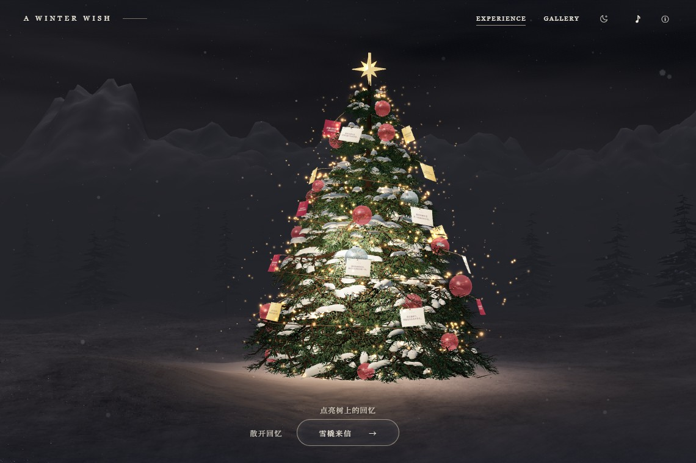
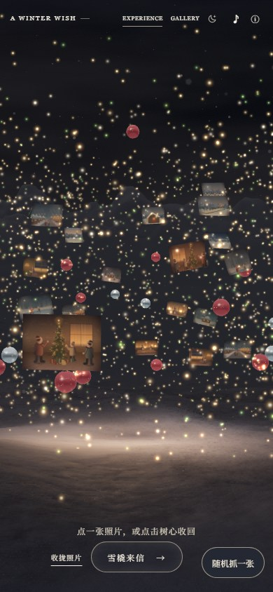
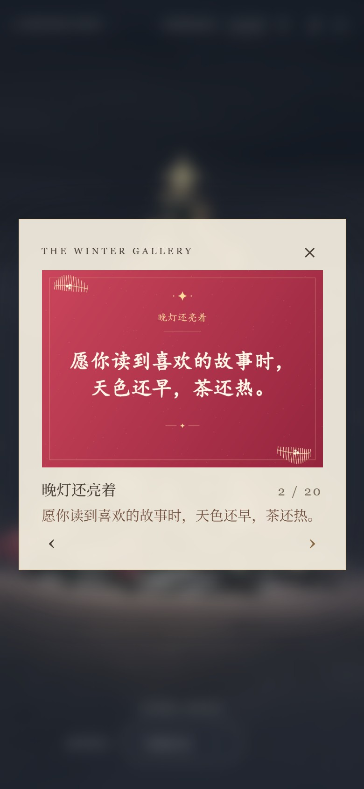
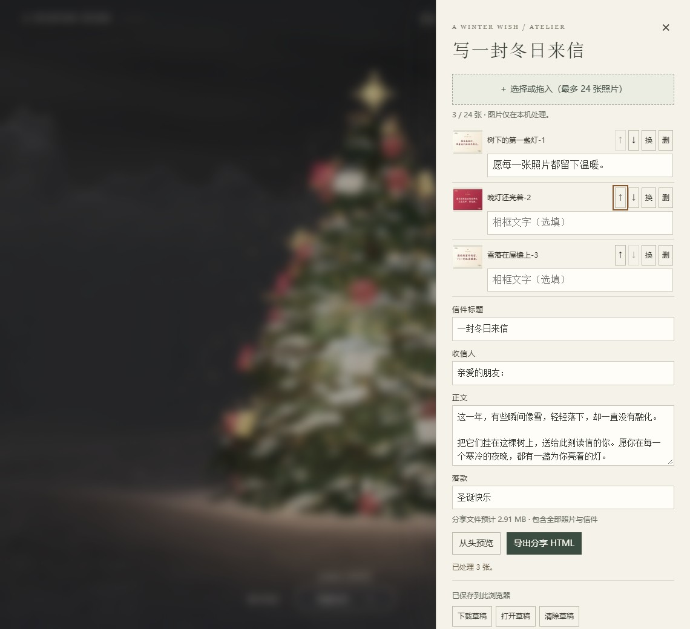

# 雪夜来信 · A Winter Wish

在圣诞雪景中拆开来信、翻看照片，也可以把自己的照片和祝福做成一份离线礼物。



## 演示版 · 体验收件人看到的效果

1. 打开[演示版 HTML](./A_Winter_Wish_Letter_Song_Lite_Demo.html)的 GitHub 文件页，选择 **下载原始文件（Download raw file）**。用浏览器打开下载的文件即可离线体验。
2. 点击信封进入雪景并开启音乐。快速横向拨动树，挂在树上的照片会扬起再摆回。桌面可以用滚轮缩放，鼠标移到画面上沿或下沿可以呼出工具栏。
3. 点树或点「散开回忆」，让雪白、莓红和暖金的祝福卡轮流靠近镜头。每张卡上都印有不同的中文祝福。想读信时，点「雪橇来信」，再擦开雪层或点「直接读信」。

<p align="center"> </p>

## 创作版 · 做一份自己的来信

1. 下载[创作版 HTML](./A_Winter_Wish_Letter_Song_Lite.html)的原始文件，用浏览器打开并拆开信封。电脑上把鼠标移到画面顶部，再点 **ATELIER**。手机上可以直接点顶部的 **ATELIER**。
2. 选择最多 **24 张** JPG、PNG 或 WebP 照片。可在每张照片下填写 **相框文字**，再编辑信件标题、收信人、正文和落款。相框文字会跟着照片保存、重排和导出。
3. 点「导出分享 HTML」，把生成的 `A_Winter_Wish_Gift.html` 发给对方。照片、信件、雪景和音乐都在这一个文件里。对方下载后用浏览器打开即可离线体验。

想留着继续编辑，可以用「下载草稿」备份，下次在 ATELIER 点「打开草稿」恢复。手机上如进入附件预览，可先下载文件，再用浏览器打开。



## 源码

下载并解压[源码包](./A_Winter_Wish_Final_Source.zip)，在解压目录中用 Node.js 22 或更新版本运行以下命令。

```bash
node scripts/pack.mjs
node scripts/verify.mjs
```

成品位于 `offline/` 目录。
